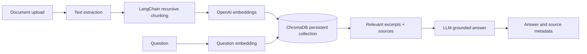

# KnowledgeBase RAG Document Assistant

A source-aware document question-answering API built with Python, FastAPI, LangChain, ChromaDB, and OpenAI. Upload PDF, DOCX, Markdown, or plain text files, then ask questions against the indexed material. Answers include retrieved source chunks and abstain when no result is relevant enough.

## Features

- Document extraction for `.pdf`, `.docx`, `.md`, and `.txt`
- Recursive chunking with configurable size and overlap
- OpenAI embeddings and persistent local ChromaDB cosine similarity search
- Grounded answer prompt with inline source references and a configurable distance cutoff
- REST endpoints for upload, query, listing, deletion, and health checks
- Pydantic request/response validation and OpenAPI docs
- Unit test examples and an API-based retrieval evaluation workflow

## Architecture



## Requirements

- Python 3.10 or newer
- An OpenAI API key with access to the configured chat and embedding models

## Run locally

```powershell
py -3.11 -m venv .venv
.\.venv\Scripts\Activate.ps1
python -m pip install -r requirements.txt
Copy-Item .env.example .env
```

Set `OPENAI_API_KEY` in `.env`, then start the API:

```powershell
uvicorn app.main:app --reload
```

Open <http://127.0.0.1:8000/docs> for interactive API documentation. ChromaDB data is stored in `./chroma_data` by default and is excluded from Git.

### Docker

Copy `.env.example` to `.env`, set the API key, then run:

```sh
docker compose up --build
```

## API examples

Upload a document:

```sh
curl -X POST http://127.0.0.1:8000/documents \
  -F "file=@architecture.md"
```

Ask a question and optionally override the number of retrieved chunks:

```sh
curl -X POST http://127.0.0.1:8000/query \
  -H "Content-Type: application/json" \
  -d '{"question":"Which vector database is used?","top_k":4}'
```

Example response:

```json
{
  "answer": "The project uses ChromaDB [1].",
  "sources": [
    {
      "filename": "architecture.md",
      "chunk": 0,
      "distance": 0.18,
      "excerpt": "The assistant uses ChromaDB as its persistent vector database..."
    }
  ],
  "abstained": false
}
```

Other endpoints:

| Method | Path | Purpose |
|---|---|---|
| `GET` | `/health` | API and index status |
| `GET` | `/documents` | List indexed files and chunk counts |
| `DELETE` | `/documents/{document_id}` | Remove one uploaded document |

## Configuration

Copy `.env.example` to `.env` and set the API key. Main options:

| Variable | Default | Purpose |
|---|---:|---|
| `OPENAI_CHAT_MODEL` | `gpt-4o-mini` | Answer generation model |
| `OPENAI_EMBEDDING_MODEL` | `text-embedding-3-small` | Embedding model for chunks and questions |
| `CHROMA_PERSIST_DIRECTORY` | `./chroma_data` | Local persistent vector index directory |
| `CHROMA_COLLECTION_NAME` | `documents` | ChromaDB collection |
| `CHUNK_SIZE` / `CHUNK_OVERLAP` | `1000` / `150` | Recursive splitter settings |
| `DEFAULT_TOP_K` / `MAX_TOP_K` | `4` / `10` | Retrieval count limits |
| `MAX_DISTANCE` | `0.7` | Maximum cosine distance retained before answer generation |
| `MAX_UPLOAD_MB` | `20` | Upload size limit |

Tune `MAX_DISTANCE` for the selected embedding model and your corpus. Chroma cosine distance is lower for closer matches. The distance threshold is a retrieval filter, not a guarantee that every generated statement is correct; review sources for high-impact use cases.

## Tests and retrieval evaluation

Run unit tests with:

```sh
python -m pytest
```

To exercise the evaluation cases, start the API and upload the fixture:

```sh
curl -X POST http://127.0.0.1:8000/documents -F "file=@eval/fixtures/architecture.md"
python eval/run_eval.py
```

The evaluation script checks expected answer terms, source presence, and abstention behavior against `eval/cases.json`. Extend the cases and fixture documents for your domain; this lightweight check is a useful regression signal, not a substitute for a labeled evaluation set.

## Repository layout

```text
app/
  config.py              Environment-backed settings
  main.py                FastAPI routes and service wiring
  schemas.py             Pydantic API models
  services/
    extract.py           PDF/DOCX/Markdown/text extraction
    rag.py               Retrieval filtering and grounded answer generation
    vector_store.py      LangChain chunking and ChromaDB persistence
eval/                    Example evaluation set and runner
tests/                   Unit test examples
```

## Notes

- Never commit `.env`, API keys, or the local `chroma_data/` index.
- Scanned PDFs require OCR before upload; this project extracts embedded PDF text.
- The service is intended as a starter project. Add authentication, rate limiting, and tenant isolation before exposing it to untrusted public traffic.

## License

MIT. See [LICENSE](LICENSE).
