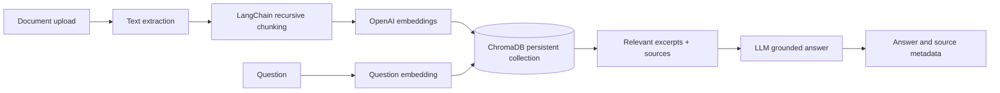

# KnowledgeBase RAG Document Assistant

A source-aware document question-answering API built with Python, FastAPI, LangChain, ChromaDB, and OpenAI. Upload PDF, DOCX, Markdown, or plain text files, then ask questions against the indexed material. Answers include retrieved source chunks and abstain when no result is relevant enough.

This repository brings document ingestion, vector retrieval, and source-aware answer generation together in a configurable backend service. It includes a persistent local vector index, an OpenAPI interface, automated unit-test examples, and a repeatable evaluation workflow for exploring document-grounded question answering.

## Contents

- [Features](#features)
- [Architecture](#architecture)
- [Design details](#design-details)
- [Requirements](#requirements)
- [Run locally](#run-locally)
- [Docker](#docker)
- [API examples](#api-examples)
- [Configuration](#configuration)
- [Testing and evaluation](#tests-and-retrieval-evaluation)
- [Operational notes](#operational-notes)
- [Repository layout](#repository-layout)
- [Notes](#notes)
- [Limitations](#limitations)
- [License](#license)

## Features

- Document extraction for `.pdf`, `.docx`, `.md`, and `.txt`
- Recursive chunking with configurable size and overlap
- OpenAI embeddings and persistent local ChromaDB cosine similarity search
- Grounded answer prompt with inline source references and a configurable distance cutoff
- REST endpoints for upload, query, listing, deletion, and health checks
- Pydantic request/response validation and OpenAPI docs
- Automated unit tests and an API-based retrieval evaluation workflow

## Technical highlights

- **Backend API:** FastAPI routes with typed Pydantic request and response models, upload validation, and generated OpenAPI documentation.
- **Document pipeline:** PDF, DOCX, Markdown, and plain-text extraction followed by configurable recursive chunking and embedding.
- **Retrieval system:** Persistent ChromaDB storage, cosine similarity search, configurable `top_k`, and a distance threshold for filtering weak matches.
- **Grounded generation:** Retrieved excerpts are passed to the chat model with source numbering, an instruction to stay within the supplied context, and an explicit abstention path.
- **Document lifecycle:** Content-derived document IDs support repeat uploads; list and delete endpoints expose basic index management.
- **Quality workflow:** Unit tests run in GitHub Actions, with a separate API-based evaluation harness for expected terms, source presence, and abstention behavior.

## Design details

### Ingestion and indexing

1. The upload route validates the file type and configured size limit.
2. Text is extracted from PDF, DOCX, Markdown, or plain-text files. PDF extraction reads embedded text; scanned pages need OCR before upload.
3. LangChain's `RecursiveCharacterTextSplitter` divides the text into overlapping chunks. Chunk size and overlap are configurable.
4. The configured OpenAI embedding model creates a vector for each chunk.
5. ChromaDB stores vectors, text, and metadata (`document_id`, filename, chunk index, and start offset) in a persistent collection.

The document ID is derived from the uploaded file content. Uploading the same content again reuses its ID and replaces its existing chunks, which avoids duplicate copies of that upload in the collection.

### Query and answer generation

1. The question is embedded with the same embedding model used for document chunks.
2. ChromaDB returns the nearest chunks using cosine distance.
3. Results above `MAX_DISTANCE` are filtered out. If none remain, the API abstains without calling the chat model.
4. The remaining excerpts are supplied to the chat model with instructions to use only those excerpts, treat their contents as reference data, and cite them inline as `[1]`, `[2]`.
5. The response includes the answer, source filenames, chunk indexes, excerpts, distances, and an `abstained` flag.

The distance cutoff is a configurable retrieval heuristic. It is not a calibrated confidence score and does not guarantee answer correctness; inspect the returned passages when evaluating an answer.

## Architecture



## Requirements

- Python 3.10 or newer
- An OpenAI API key with access to the configured chat and embedding models
- Network access from the service to the OpenAI API for embedding and chat requests

## Run locally

```powershell
py -3.11 -m venv .venv
.\.venv\Scripts\Activate.ps1
python -m pip install -r requirements.txt
Copy-Item .env.example .env
```

Set `OPENAI_API_KEY` in `.env`, then start the API:

```powershell
uvicorn app.main:app --reload
```

Open <http://127.0.0.1:8000/docs> for interactive API documentation. ChromaDB data is stored in `./chroma_data` by default and is excluded from Git.

The service can start without an API key so the OpenAPI documentation is available, but service operations that initialize the vector store require `OPENAI_API_KEY`. Without a key, `/health` reports that the service is unavailable and upload/query requests cannot run.

### Docker

Copy `.env.example` to `.env`, set the API key, then run:

```sh
docker compose up --build
```

The compose service publishes the API on port `8000` and mounts `./chroma_data` so the local ChromaDB index survives container restarts. Keep `.env` private; it is excluded from Git.

### Linux and macOS shell

The following commands mirror the local setup for a Unix-like shell:

```sh
python3 -m venv .venv
source .venv/bin/activate
python -m pip install -r requirements.txt
cp .env.example .env
# Edit .env and set OPENAI_API_KEY before using upload or query routes.
uvicorn app.main:app --reload
```

The application has been started locally on Windows. Docker and Unix-like setup instructions are included; use the deployment environment's normal validation process before relying on a deployment.

## API examples

Upload a document:

```sh
curl -X POST http://127.0.0.1:8000/documents \
  -F "file=@architecture.md"
```

Ask a question and optionally override the number of retrieved chunks:

```sh
curl -X POST http://127.0.0.1:8000/query \
  -H "Content-Type: application/json" \
  -d '{"question":"Which vector database is used?","top_k":4}'
```

Example response:

```json
{
  "answer": "The project uses ChromaDB [1].",
  "sources": [
    {
      "filename": "architecture.md",
      "chunk": 0,
      "distance": 0.18,
      "excerpt": "The assistant uses ChromaDB as its persistent vector database..."
    }
  ],
  "abstained": false
}
```

Other endpoints:

| Method | Path | Purpose |
|---|---|---|
| `GET` | `/health` | API and index status |
| `GET` | `/documents` | List indexed files and chunk counts |
| `DELETE` | `/documents/{document_id}` | Remove one uploaded document |

### Endpoint behavior

| Endpoint | Success | Common errors |
|---|---|---|
| `POST /documents` | `201`, filename, document ID, and number of indexed chunks | `413` for oversized uploads, `415` for unsupported types, `422` for documents with no extractable text, `502` for indexing failures |
| `POST /query` | `200`, answer, source chunks, and abstention flag | `422` for invalid request values or `top_k` above `MAX_TOP_K`, `502` for embedding or answer-generation failures |
| `GET /documents` | `200`, indexed documents with chunk counts | `503` if the index is unavailable |
| `DELETE /documents/{document_id}` | `200`, deletion result | `404` if the document ID does not exist |
| `GET /health` | `200`, collection name and indexed chunk count | `503` if the service is not configured or the index is unavailable |

`top_k` is optional and defaults to `DEFAULT_TOP_K`. The API rejects values above `MAX_TOP_K` even if they pass the request schema's upper bound. Filenames are returned as source metadata; document contents are not returned by the list endpoint.

## Configuration

Copy `.env.example` to `.env` and set the API key. Main options:

| Variable | Default | Purpose |
|---|---:|---|
| `OPENAI_CHAT_MODEL` | `gpt-4o-mini` | Answer generation model |
| `OPENAI_EMBEDDING_MODEL` | `text-embedding-3-small` | Embedding model for chunks and questions |
| `CHROMA_PERSIST_DIRECTORY` | `./chroma_data` | Local persistent vector index directory |
| `CHROMA_COLLECTION_NAME` | `documents` | ChromaDB collection |
| `CHUNK_SIZE` / `CHUNK_OVERLAP` | `1000` / `150` | Recursive splitter settings |
| `DEFAULT_TOP_K` / `MAX_TOP_K` | `4` / `10` | Retrieval count limits |
| `MAX_DISTANCE` | `0.7` | Maximum cosine distance retained before answer generation |
| `MAX_UPLOAD_MB` | `20` | Upload size limit |

Tune `MAX_DISTANCE` for the selected embedding model and your corpus. Chroma cosine distance is lower for closer matches. The distance threshold is a retrieval filter, not a guarantee that every generated statement is correct; review sources for high-impact use cases.

## Tests and retrieval evaluation

Run unit tests with:

```sh
python -m pytest
```

To exercise the evaluation cases, start the API and upload the fixture:

```sh
curl -X POST http://127.0.0.1:8000/documents -F "file=@eval/fixtures/architecture.md"
python eval/run_eval.py
```

The evaluation script checks expected answer terms, source presence, and abstention behavior against `eval/cases.json`. Extend the cases and fixture documents for your domain; this lightweight check is a useful regression signal, not a substitute for a labeled evaluation set.

The repository also includes a GitHub Actions workflow that installs the requirements and runs the unit tests on pushes and pull requests. The evaluation script calls a running API and uses the configured embedding and chat APIs, so it is intentionally run separately from the unit-test workflow.

### Verification status

- The API process has been started locally on Windows; the interactive docs and OpenAPI schema returned HTTP `200`.
- Service readiness depends on a configured OpenAI API key and an available ChromaDB index. The health route reports `503` when required service configuration is missing.
- The GitHub Actions workflow runs the unit-test suite on pushes and pull requests.
- The supplied evaluation file is a small example set. Extend it with domain-specific questions and report measured results from your target corpus.

## Repository layout

```text
app/
  config.py              Environment-backed settings
  main.py                FastAPI routes and service wiring
  schemas.py             Pydantic API models
  services/
    extract.py           PDF/DOCX/Markdown/text extraction
    rag.py               Retrieval filtering and grounded answer generation
    vector_store.py      LangChain chunking and ChromaDB persistence
eval/                    Example evaluation set and runner
tests/                   Unit test examples
```

## Operational notes

- The local vector database is persisted to `CHROMA_PERSIST_DIRECTORY`; back up this directory if the indexed data must be retained.
- Embedding and answer generation are external API calls. Uploading a document incurs embedding requests; each query may make an embedding request and, if relevant chunks are found, a chat completion request.
- The service reads each upload into memory before checking its configured size. The default limit is 20 MB; set an appropriate limit for the deployment environment.
- ChromaDB is initialized as a persistent local collection. For multi-instance or high-availability deployments, plan a shared vector database and coordinated document lifecycle.
- `GET /health` is a readiness-style check: it initializes the configured services and checks access to the collection. It is not a liveness-only process check.

## Limitations

- Never commit `.env`, API keys, or the local `chroma_data/` index.
- Scanned PDFs require OCR before upload; this project extracts embedded PDF text.
- DOCX extraction currently reads paragraph text; content in tables, headers, footers, or embedded media may not be indexed.
- The starter API does not include authentication, rate limiting, tenant isolation, background indexing, or a production-grade distributed vector store. Add and test the controls required by your deployment before exposing it to untrusted public traffic.
- Retrieval quality depends on document structure, chunk settings, embedding model, distance threshold, and question wording. The included evaluation set is illustrative and too small to support broad quality claims.

## Notes

- Never commit `.env`, API keys, or the local `chroma_data/` index.
- Scanned PDFs require OCR before upload; this project extracts embedded PDF text.
- The service is intended as a starter project. Add authentication, rate limiting, and tenant isolation before exposing it to untrusted public traffic.

## License

MIT. See [LICENSE](LICENSE).
